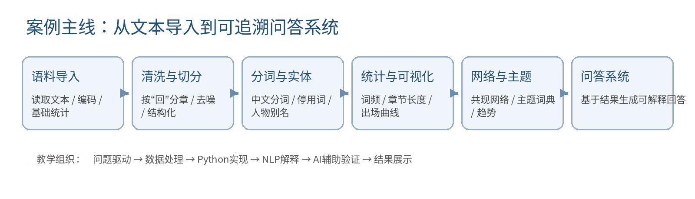
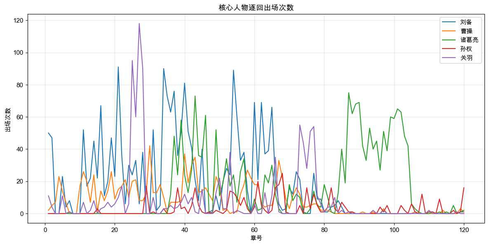
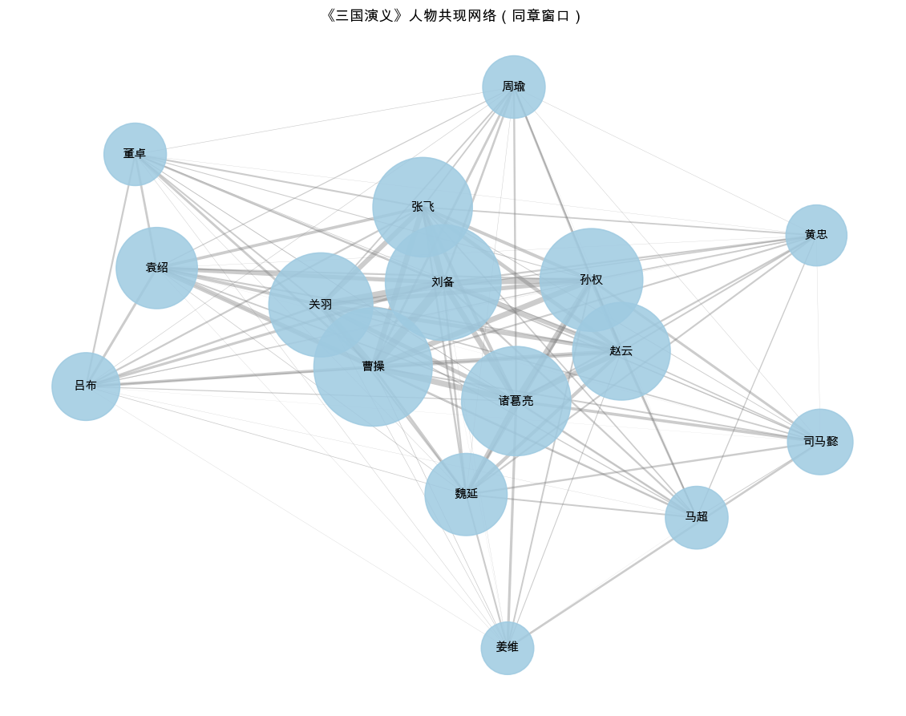
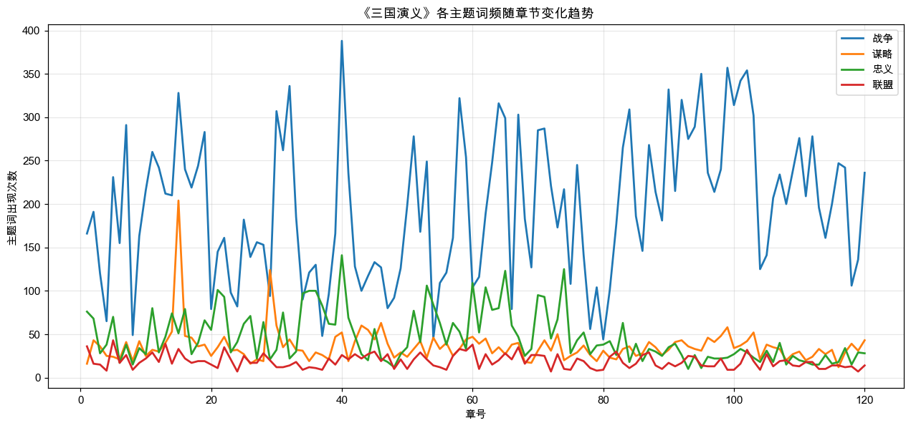
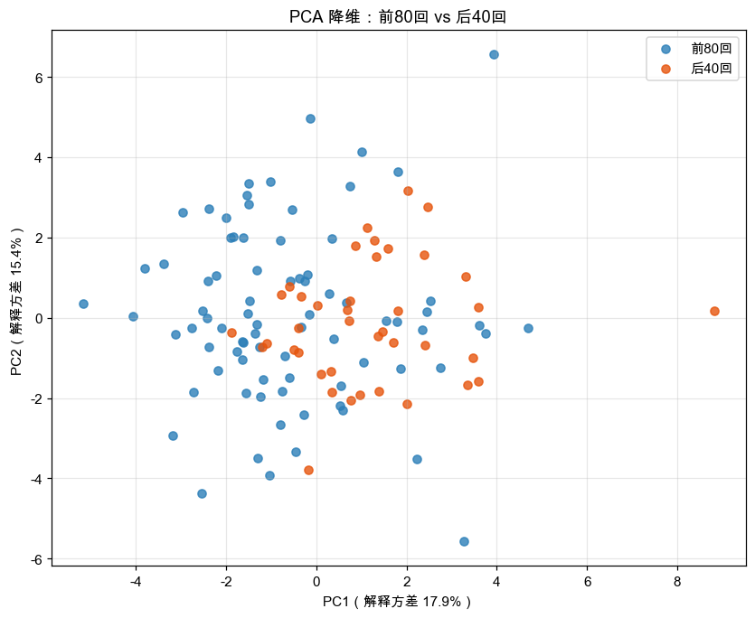

# 《三国演义》Python 与 NLP 实验

> 基于《三国演义》的案例化 Python 与自然语言处理实验：从文本导入 → 清洗切分 → 分词与实体 → 统计与可视化 → 网络与主题 → 可追溯问答。

Python 3.10+ · Jupyter Notebook · MIT License

本项目把一份课程实验手册整理成一个**结构清晰、过程可复现**的开源工程：11 个实验对应 11 个 Notebook，公共逻辑收敛到 `src/sanguo_nlp/`，所有图表与统计表都由 Notebook 实际运行生成并保存在 `outputs/`。原始手册中的姓名、学号、班级等个人信息已全部移除。

## 实验主线



## 目录结构

```text
sanguo-nlp-lab/
├── README.md
├── LICENSE
├── requirements.txt
├── Makefile
├── data/
│   ├── raw/sanguoyanyi.txt          # 《三国演义》全文（120 回）
│   ├── stopwords_cn.txt             # 中文通用停用词表
│   └── lexicons/
│       ├── character_aliases.csv    # 16 位核心人物别名表
│       └── topic_lexicon.json       # 战争 / 谋略 / 忠义 / 联盟 主题词典
├── src/sanguo_nlp/                  # 可复用分析工具包
│   ├── paths.py                     # 仓库路径与输出目录
│   ├── corpus.py                    # 语料读取、清洗、按回切分
│   ├── lexicons.py                  # 停用词、别名、主题词典加载
│   ├── text.py                      # jieba 分词与词过滤
│   ├── mentions.py                  # 人物提及统计（别名归一）
│   ├── topics.py                    # 主题词典统计
│   ├── cooccurrence.py              # 共现边表、网络与中心性
│   ├── similarity.py                # TF-IDF、关键词、章节相似度
│   ├── coherency.py                 # 全文一致性语言特征
│   └── qa.py                        # 可追溯问答
├── notebooks/                       # 11 个实验（已执行，带输出）
│   ├── exp01_corpus_overview.ipynb
│   ├── exp02_chapter_split.ipynb
│   ├── exp03_chapter_length.ipynb
│   ├── exp04_word_frequency.ipynb
│   ├── exp05_character_normalization.ipynb
│   ├── exp06_character_trends.ipynb
│   ├── exp07_cooccurrence_network.ipynb
│   ├── exp08_theme_lexicon.ipynb
│   ├── exp09_tfidf_similarity.ipynb
│   ├── exp10_traceable_qa.ipynb
│   └── exp11_style_coherency.ipynb
├── outputs/
│   ├── figures/                     # 12 张图表
│   ├── tables/                      # 13 张统计表
│   └── qa_report.md                 # 可追溯问答报告
├── scripts/
│   ├── run_all_notebooks.py         # 依次执行全部 Notebook
│   └── run_pipeline.py              # 不依赖 Notebook 的最小流程
└── docs/
    ├── lab-manual.md                # 清洗后的实验手册
    └── images/pipeline.png
```

## 快速开始

```bash
git clone https://github.com/<your-name>/sanguo-nlp-lab.git
cd sanguo-nlp-lab

python -m venv .venv
source .venv/bin/activate          # Windows: .venv\Scripts\activate
pip install -r requirements.txt
```

运行全部实验并重新生成 `outputs/`：

```bash
python scripts/run_all_notebooks.py
# 或：make notebooks
```

也可以只跑最小流程（清洗 → 人物统计 → 共现边表）：

```bash
python scripts/run_pipeline.py
```

## 实验与产出对照

| 实验 | Notebook | 主要输出 |
| --- | --- | --- |
| 1 文本导入与语料认识 | `exp01_corpus_overview.ipynb` | `outputs/tables/corpus_stats.csv` |
| 2 文本清洗与按回切分 | `exp02_chapter_split.ipynb` | `outputs/tables/chapters.csv` |
| 3 章节长度统计与可视化 | `exp03_chapter_length.ipynb` | `chapter_length.csv`、`figure: chapter_length.png` |
| 4 中文分词与高频词 | `exp04_word_frequency.ipynb` | `high_freq_words.csv`、词频图、词云 |
| 5 人物识别与别名归一 | `exp05_character_normalization.ipynb` | `character_frequencies.csv` |
| 6 主要人物出场规律 | `exp06_character_trends.ipynb` | `character_trends.csv`、出场曲线与密度曲线 |
| 7 人物共现网络 | `exp07_cooccurrence_network.ipynb` | `character_cooccurrence_edges.csv`、`character_centrality.csv`、网络图 |
| 8 主题词典与趋势 | `exp08_theme_lexicon.ipynb` | `topic_trends.csv`、主题趋势图 |
| 9 关键词与章节相似度 | `exp09_tfidf_similarity.ipynb` | `chapter_tfidf_keywords.csv`、`chapter_similarity.csv`、`chapter_clusters.csv` |
| 10 可追溯问答助手 | `exp10_traceable_qa.ipynb` | `outputs/qa_report.md` |
| 11 全文一致性分析 | `exp11_style_coherency.ipynb` | `style_features.csv`、`style_tests.csv`、PCA 图 |

## 主要结果

### 1. 语料概况（实验 1–2）

| 指标 | 数值 |
| --- | --- |
| 总字符数 | 602,415 |
| 非空行数 | 1,585 |
| 切分得到的章回数 | 120 |
| 空行数 | 3 |

清洗规则：去 BOM、统一换行与全角空格、删除第 40 回结尾的目录式残留 `#第四十一回…`、合并连续空行。切分时**只匹配行首**的回目标记，避免正文中引用“第 X 回”造成误切分。

### 2. 人物出场（实验 5–6）

别名归一后的人物提及次数 Top5：**刘备 2224、诸葛亮 1901、曹操 1037、关羽 981、赵云 447**。



刘备在前 40 回出场密集（峰值第 21、34、37、40、54 回）；诸葛亮在 35 回之后显著上升（峰值第 43、87、89、90、101 回）；关羽在第 25—28 回出现明显尖峰，对应下邳之围到千里走单骑。

### 3. 人物共现网络（实验 7）

共现窗口取**同章**。共现次数最高的关系为：刘备—曹操 72、关羽—刘备 53、关羽—曹操 53、刘备—张飞 49、孙权—诸葛亮 49。按加权度排序的核心节点是曹操、刘备、诸葛亮、关羽、孙权。



### 4. 主题趋势（实验 8）

| 主题 | 峰值章节 | 峰值次数 | 均值 ± 标准差 |
| --- | --- | --- | --- |
| 战争 | 第 40 回 | 388 | 196.8 ± 82.7 |
| 谋略 | 第 15 回 | 204 | 36.0 ± 20.5 |
| 忠义 | 第 40 回 | 141 | 46.2 ± 28.8 |
| 联盟 | 第 5 回 | 43 | 18.8 ± 8.0 |



### 5. 章节相似度（实验 9）

TF-IDF 余弦相似度最高的章节对：第 40–41 回 0.893、第 25–27 回 0.890、第 27–28 回 0.877。相似度高的章节对大多来自同一叙事单元（如第 25—28 回的下邳—古城系列、第 40—41 回的荆州系列），说明“人物 + 主题 + 场景”共同决定了章节的相似性。

### 6. 全文一致性（实验 11）

以每回为样本，提取 TTR、平均句长、文言虚词频率、标点频率、词性分布等 25 个特征，比较前 80 回与后 40 回：

- **PCA**：两组大面积重叠，没有清晰分界；
- **分类器**：逻辑回归 5 折交叉验证准确率 **0.767 ± 0.136**，高于多数类基线 **0.667**；
- **统计检验**：未校正时有 13/25 个特征 p < 0.05，最显著的是平均句长（p ≈ 3e-11）与虚词“与”。



结论更接近**全书连续、存在轻微风格漂移**，而不是风格断裂。语言风格分析只能提供“可区分 / 不可区分”的统计证据，不能直接证明作者身份。

## 可追溯问答示例（实验 10）

问答助手只读取 `outputs/tables/` 中已经落盘的统计表，每个结论都附带证据来源，完整报告见 `outputs/qa_report.md`。

| 问题 | 结论 | 依据 |
| --- | --- | --- |
| 谁出场最多？ | 刘备 2224、诸葛亮 1901、曹操 1037 | `character_frequencies.csv` |
| 哪几章曹操最活跃？ | 第 30、40、43、67、42 回 | `character_trends.csv` |
| 谁与诸葛亮共现最多？ | 孙权 49、曹操 47、刘备 44 | `character_cooccurrence_edges.csv` |
| 与第 37 回最相似？ | 第 36、38、21 回 | `chapter_similarity.csv` |
| 哪些章节最像战争篇？ | 第 40、99、102、95、101 回 | `topic_trends.csv` |

## 对原手册的适度优化

- **公共逻辑下沉到工具包**：语料清洗、按回切分、别名归一、共现、相似度等只在 `src/sanguo_nlp/` 实现一次，Notebook 只保留实验步骤与解释，避免各实验复制粘贴。
- **修正原有缺陷**：只匹配行首回目标记（原来会把正文中引用的“第 X 回”也切开）；别名采用**长别名优先**正则，避免“刘玄德”又被“玄德”重复计数；补上原实验 6、10 中缺失的逐章人物频次表；修复原实验 3 缺失的 `长度` 列、实验 9 的 `pairs` 未定义等问题。
- **统一相对路径与输出目录**：所有数据、图表、表格都通过 `sanguo_nlp.paths` 解析，换机器不需要改路径；输出统一放到 `outputs/figures/` 与 `outputs/tables/`。
- **可复现**：`scripts/run_all_notebooks.py` 一键重跑 11 个 Notebook，并把运行结果写回 Notebook。
- **去个人信息**：姓名、学号、班级以及本地用户名、绝对路径等均已从手册与代码中移除。

## 数据与字段

- 语料：`data/raw/sanguoyanyi.txt`，UTF-8 带 BOM，作者罗贯中（明代），已进入公有领域，仅供教学与研究使用。
- 停用词：`data/stopwords_cn.txt`，中文通用停用词表。
- 章节表 `outputs/tables/chapters.csv` 字段：`章号 / 回目 / 标题 / 正文`。

## 许可与个人信息

代码以 **MIT License** 发布。仓库中不包含任何姓名、学号、班级等个人信息；如发现遗漏，欢迎提 issue 指出。

## 参考

- 实验手册（清洗版）：`docs/lab-manual.md`
- 数据说明：`data/README.md`
